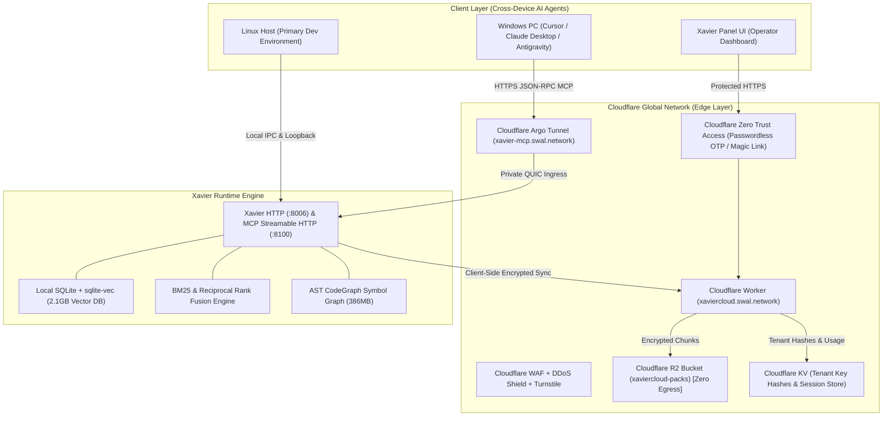

# Xavier & Cloudflare: Enterprise Zero-Trust Architecture for AI Cognitive Memory

> **Positioning:** Cloudflare for Startups Partnership & Architectural Specification  
> **Status:** Active & Production-Verified  
> **Author:** SouthWest AI Labs (SWAL) & Xavier Core Team  
> **Date:** November 2026  

---

## 1. Executive Summary: Why Xavier Builds on Cloudflare

**Xavier** is a high-performance cognitive vector memory runtime designed for autonomous AI agents. Rather than managing complex, fragile, and vulnerable self-hosted cloud servers, Xavier delegates its entire network perimeter, authentication, edge distribution, and cold persistence to **Cloudflare**.

By anchoring Xavier into Cloudflare’s global edge network (spanning 300+ cities), Xavier achieves:
1. **Zero-Trust Perimeter:** Every API, Web Panel, and MCP Streamable HTTP call is guarded by Cloudflare WAF, DDoS mitigation, and Cloudflare Zero Trust (Access) without exposing internal listening ports to the public internet.
2. **Zero-Knowledge Privacy:** Memory vectors and records are encrypted on the client device (Argon2id KDF + AES-256-GCM authenticated cipher) *before* reaching Cloudflare R2. Cloudflare stores only opaque encrypted chunks (`XCB1`).
3. **Zero-Egress Data Economics:** Unlike AWS S3 or Google Cloud Storage, Cloudflare R2 charges **\$0.00 for data egress**. This enables AI agents to pull gigabytes of vector embeddings and context snapshots without runaway bandwidth bills.
4. **Sub-Millisecond Edge Routing:** Remote AI agents connecting via Windows, macOS, Linux, or cloud environments query Xavier memory over Cloudflare Universal SSL with HTTP/2 & HTTP/3 (QUIC) multiplexing.

---

## 2. Architectural Blueprint

---

## 3. Core Features & "Why Each Exists"

| Feature | Technical Implementation | Why It Exists in Xavier | Cloudflare Service Used |
|---|---|---|---|
| **Remote MCP over HTTPS** | Streamable JSON-RPC on port 8100 with `Origin` and `Host` header allowlisting. | Enables agents running on Windows or cloud VMs to query local memory securely without port forwarding. | **Cloudflare Tunnel (`cloudflared`) + Universal SSL** |
| **Zero-Knowledge Cloud Backup** | Argon2id KDF, per-pack HMAC-SHA256, AES-256-GCM encryption with client-side passphrase. | Protects agent thoughts, developer secrets, and proprietary code context from operator or cloud provider compromise. | **Cloudflare R2 (`xaviercloud-packs`)** |
| **Multi-Tenant Rate Limiting & Quotas** | SHA-256 hashed API keys mapped to tenant IDs; byte counter tracked per upload chunk. | Prevents denial-of-wallet, isolates agent teams, and enforces subscription tiers. | **Cloudflare KV (`XAVIER_CLOUD_KV`)** |
| **Passwordless Magic Link & Zero Trust** | Cloudflare Access OTP & Worker-based Magic Link with atomic single-use token redemption. | Operators log in without typing or exposing master root keys (`XAVIER_TOKEN`) in browser memory or URL history. | **Cloudflare Access + Email Service + D1/Durable Objects** |
| **Hybrid Edge Vector Scoring** | `crates/xavier-core-logic` compiled to WebAssembly (`wasm32-unknown-unknown`). | Runs BM25 and Reciprocal Rank Fusion directly at edge locations with <10ms latency. | **Cloudflare Workers (WASM)** |

---

## 4. Economic Viability & Unit Economics (SaaS Business Model)

### 4.1 Cloudflare Free Tier Consumption vs Real Usage
Audited on November 2, 2026 across the active SWAL deployment:
* **Real Corpus:** 42,878 memories across 5 workspaces.
* **Encrypted Compressed Size:** **75.75 MiB** in 34 packs.
* **Cloudflare R2 Free Limit:** 10,240 MiB (10 GiB) / month.
* **Current Free Tier Consumption:** **0.74% of free storage capacity**.
* **Cloudflare Workers Invocations:** <1,000 / day (out of 100,000 free requests/day).
* **Egress Cost:** **\$0.00** (Cloudflare R2 has zero egress bandwidth charges).

### 4.2 SaaS Profitability Model (Breakeven at $\le 4$ Subscribers)

| Tier | Price / Month | Storage Included | Cost to Serve (Cloudflare) | Gross Margin |
|---|---|---|---|---|
| **Individual Agent** | \$10 / mo | 2 GB (~100,000 memories) | \$0.03 (R2 overage: \$0.015/GB) | **99.7%** |
| **Pro Multi-Agent** | \$25 / mo | 10 GB (~500,000 memories) | \$0.15 (R2) + \$0.05 (Workers) | **99.2%** |
| **Team / Swarm** | \$75 / mo | 50 GB (~2,500,000 memories) | \$0.75 (R2) + \$0.20 (Workers) | **98.7%** |

#### Breakeven Analysis:
- Even on the paid Cloudflare Workers plan (**\$5.00/month flat**), **a single subscriber at \$10/month covers 200% of the entire infrastructure cost**.
- With **4 subscribers**, monthly revenue is \$40.00 against \$5.00 in Cloudflare base cost = **\$35.00 net monthly operating profit (87.5% margin)**.
- Unlike traditional SaaS running AWS RDS and EC2 instances costing \$150–\$300/mo minimum, the Cloudflare-native Xavier architecture scales from 0 to 1,000 users with zero idle compute waste.

---

## 5. Startup Sponsorship Eligibility (Cloudflare for Startups)

Xavier fulfills all core requirements for the **Cloudflare for Startups** grant:
1. **Cloudflare-Native Architecture:** 100% of routing, edge compute, and object storage leverages Cloudflare APIs (Workers, Pages, R2, KV, Tunnels, Access).
2. **AI Ecosystem Multiplier:** Enables hundreds of AI developers and autonomous agents to build persistent workflows on top of Cloudflare infrastructure.
3. **Data Gravity:** Brings massive encrypted vector workloads and agent transcripts into Cloudflare R2 and D1.
